<!-- ═══════════════ HERO · black hole → galaxy → name ═══════════════ -->

  

  
  
  

<!-- ═══════════════ 01 · MISSION LOG ═══════════════ -->

<!-- ═══════════════ 02 · SKILL CONSTELLATION ═══════════════ -->

<!-- ═══════════════ 03 · FEATURED PLANETS ═══════════════ -->

  <a href="https://sanzidahmed4.github.io/ClickCounter/">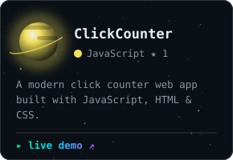</a>
  <a href="https://github.com/sanzidahmed4/portfolio">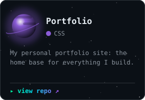</a>
  <a href="https://github.com/sanzidahmed4/catering-service">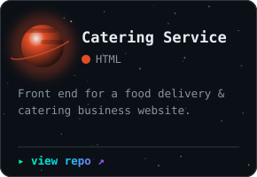</a>

  more orbits →
  <a href="https://github.com/sanzidahmed4/musical_band-metalic">musical band</a> ·
  <a href="https://github.com/sanzidahmed4/agricultural-website">agriculture</a> ·
  <a href="https://github.com/sanzidahmed4/training-institute">training institute</a> ·
  <a href="https://github.com/sanzidahmed4/Traveling-website">traveling</a> ·
  <a href="https://github.com/sanzidahmed4?tab=repositories">all repositories</a>

<!-- ═══════════════ 04 · COMMIT GALAXY (refreshed daily by .github/workflows/commit-galaxy.yml) ═══════════════ -->

<!-- ═══════════════ 05 · JOURNEY ═══════════════ -->

<!-- ═══════════════ 06 · TRANSMISSION ═══════════════ -->

  
  
  
  

✦ every visual on this page is generated from code · <a href="./generate_sections.py">see how</a> ✦

